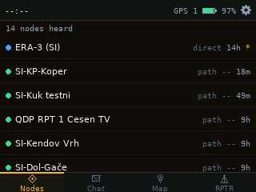
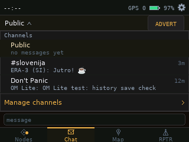
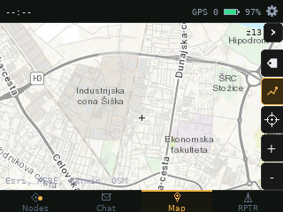
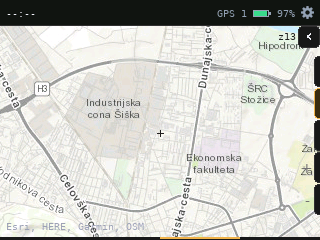
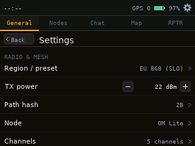
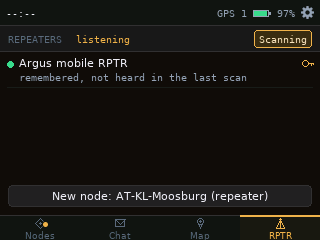

# OM Lite for the Seeed Wio Tracker L2 Pro

OM Lite is a MeshCore app for the Seeed Studio Wio Tracker L2 Pro. It runs on the device itself, so you can chat,
check nodes, use an offline map and manage repeaters without a phone.

The L2 Pro has an ESP32-S3, an SX1262 LoRa radio, GPS, a 3.2" touch screen, a speaker, an SD card slot and a
3000 mAh battery. This firmware uses all of it.

OM Lite is a handheld version of [OverMesh](https://github.com/Slofi/overmesh), our MeshCore dashboard.

Status: work in progress. It is my everyday carry (EDC) device.

<p align="center">
  
  
</p>
<p align="center">
  
  
</p>
<p align="center">
  
  
</p>

## Features

### Chat
- Channels and direct messages
- Unread counts per chat, channel/DM dropdown
- On-screen keyboard with a numbers page and an emoji page
- Long press `s`, `c`, `z` for `š`, `č`, `ž`
- Colour emoji (Noto)
- Message menu: reply, mention, copy, DM the sender, node info, path
- Delivery status on DMs
- Chat history on the SD card
- Pop-up for new messages, tap to close

### Nodes
- List of heard nodes with the time they were last heard
- Long press a node: DM, info, ping, trace, show on map, favourite, remove
- Pop-up and sound for new nodes

### Map
- Offline tiles from the SD card
- Own position from GPS
- Message traces through repeaters (toggle)

### Repeaters
- Scan for nearby repeaters
- Login with remembered passwords
- Status: battery, noise floor, uptime, clock
- Settings: name, position (with a map picker), radio, TX power, regions, neighbours
- Set the repeater's clock from the L2's GPS time

### Other
- Time from GPS, Wi-Fi or the phone
- Wi-Fi (off by default)
- Bluetooth for the MeshCore phone app (off by default)
- Sound library with about 40 notification sounds
- Settings with a tab per screen
- Crash reports on the next boot

## How it is built

MeshCore runs from its own companion code, unchanged, in `lib/meshcore` and `lib/meshcore_companion` (MIT).
OM Lite talks to it through its public API. To move to a new MeshCore release, run
`tools/update_meshcore.py <tag>` and check the board code in `src/target.*`.

The UI is in `src/ui/`. Logic is covered by host tests in `test/host/`.

## Build and flash

You need [PlatformIO](https://platformio.org/).

```sh
pio run -e om_lite_l2
```

First flash: hold BOOT, tap RESET, run `pio run -e om_lite_l2 -t upload`, tap RESET again.

After that the firmware updates over USB:

```sh
python3 tools/ota_send.py <path to firmware.bin> /dev/ttyACM0
```

Other tools in `tools/`:
- `shot.py` saves a screenshot from the device
- `cmd.py` sends test commands (send a message, list nodes, tap the screen)

The map tile pack is not included. Put your own on the SD card.

## Credits

- [MeshCore](https://github.com/meshcore-dev/MeshCore) (MIT)
- [LovyanGFX](https://github.com/lovyan03/LovyanGFX), [RadioLib](https://github.com/jgromes/RadioLib),
  [JPEGDEC](https://github.com/bitbank2/JPEGDEC)
- [Noto Color Emoji](https://github.com/googlefonts/noto-emoji) (SIL OFL), DejaVu fonts
- Feature ideas from WadaMesh and OverMesh. No WadaMesh code is used.

Built with Claude and DeepSeek. Development notes are in [`docs/PROGRESS.md`](docs/PROGRESS.md).

## Licence

OM Lite is licensed under the MIT License, see [`LICENSE`](LICENSE).

Third-party parts keep their own licences: MeshCore (MIT) in `lib/meshcore` and `lib/meshcore_companion`, Noto Color Emoji (SIL OFL 1.1), the DejaVu fonts (Bitstream Vera licence), LovyanGFX (FreeBSD), RadioLib (MIT) and JPEGDEC (Apache-2.0).
