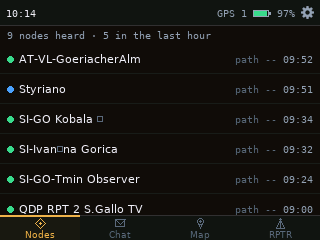
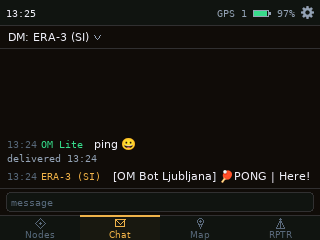
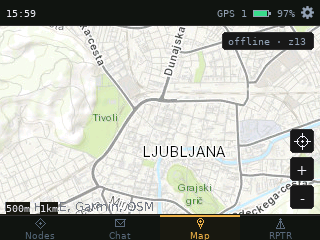
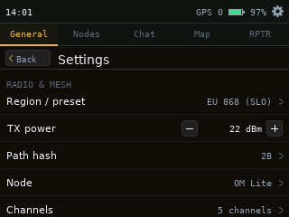

# OM Lite for the Seeed Wio Tracker L2 Pro

A pocket MeshCore handheld that works on its own. No phone, no laptop, no cloud.

OM Lite turns the [Seeed Studio Wio Tracker L2 Pro](https://www.seeedstudio.com/) (ESP32-S3, SX1262 LoRa radio,
GPS, 3.2" touch screen, speaker, SD card, 3000 mAh battery) into a little mesh terminal you can carry around: read
and send messages, see who is around, look at an offline map, and look after your own repeaters, all from the
device in your hand.

It is the small sibling of [OverMesh](https://github.com/Slofi/overmesh), the dashboard we run at home, and it
speaks [MeshCore](https://github.com/meshcore-dev/MeshCore).

> **Status:** work in progress, but very usable. It runs every day on a real L2 Pro on the Slovenian MeshCore mesh.
> Expect things to keep changing.

<p align="center">
  
  
</p>
<p align="center">
  
  
</p>

## What it can do

**Chat**
- Channels and direct messages, with a dropdown to jump between them and unread counts on each.
- A proper on-screen keyboard: hold `s`, `c` or `z` for `š`, `č`, `ž`, a numbers page, and an emoji page.
- Colour emoji in messages (the full Noto set).
- Tap a message for Reply, Mention, Copy, Direct message, the sender's node, the path it took, and more.
- Delivery receipts on direct messages ("delivered 14:02").
- Chat history saved on the SD card, so it survives restarts.
- A short pop-up when something arrives; a tap dismisses it without pressing anything underneath.

**Nodes**
- Everyone you have heard, with real times ("heard 14:02") instead of "5 min ago".
- Long-press a node for Info, Ping, Trace, Show on map, Favourite and Remove.
- A notice and a sound when a new node shows up.

**Map**
- Offline map tiles from the SD card, with your position from the built-in GPS.

**Repeaters (RPTR)**
- Opens with a scan of the repeaters around you.
- Log in, then see battery, noise floor, uptime and the repeater's clock at a glance.
- Change name, position (with a map picker), radio, regions and more. Every change is one Apply.
- Fix a repeater's clock from the L2's own GPS time with one tap.

**The rest**
- Real time from GPS (it even works indoors once a single satellite is heard).
- Wi-Fi (off by default) for internet time.
- Bluetooth (off by default): the MeshCore phone app can use the L2 as its radio.
- A small sound synthesizer with a library of notification sounds, one for every kind of event.
- Settings with a tab for each screen.
- Looks after its own memory, stack and crashes: if something ever goes wrong, it says where on the next boot.

## How it is built

- **MeshCore stays MeshCore.** The mesh runs on MeshCore's own companion code, copied in unchanged
  (`lib/meshcore`, `lib/meshcore_companion`, MIT). Our code only talks to it through its public interface, so a
  new MeshCore release is a matter of running `tools/update_meshcore.py <tag>` and checking the board glue.
- **Everything on screen is ours** (`src/ui/`): one theme file, one layout, one rectangle for drawing and tapping,
  and every frame drawn off-screen first so nothing flickers.
- **Lots of small host tests** (`test/host/`), so most logic is checked on a normal computer before it ever
  reaches the device.

## Building and flashing

You need [PlatformIO](https://platformio.org/).

```sh
pio run -e om_lite_l2
```

**The very first time**, put the L2 into download mode (hold BOOT, tap RESET) and flash with
`pio run -e om_lite_l2 -t upload`, then tap RESET once.

**After that**, no buttons are needed. The firmware updates itself over the USB cable:

```sh
python3 tools/ota_send.py <path to firmware.bin> /dev/ttyACM0
```

A few more helpers live in `tools/`: `shot.py` takes a screenshot of the device over USB, and `cmd.py` sends test
commands (send a message, list nodes, tap the screen) so the firmware can be tested without a finger on the glass.

The offline map pack is not part of this repo. The map reads a tile pack from the SD card.

## Credits

- [MeshCore](https://github.com/meshcore-dev/MeshCore) (MIT), the mesh itself.
- [LovyanGFX](https://github.com/lovyan03/LovyanGFX), [RadioLib](https://github.com/jgromes/RadioLib) and
  [JPEGDEC](https://github.com/bitbank2/JPEGDEC).
- [Noto Color Emoji](https://github.com/googlefonts/noto-emoji) (SIL Open Font License) and the DejaVu fonts.
- Ideas for features came from WadaMesh and from our own OverMesh. No code from WadaMesh is used here.

Made in Slovenia by Filip, with a lot of help from two AIs: Claude (design, review and testing) and DeepSeek
(building). The full story of each step is in [`docs/PROGRESS.md`](docs/PROGRESS.md).

## Licence

Not chosen yet. The bundled third-party parts keep their own licences (see their folders).
